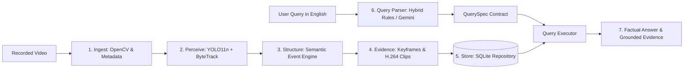

# Semantic CCTV Event Retrieval and Temporal Multi-Camera Incident Reconstruction

**PBL-III (AIM3170) Project**  
*Manipal University Jaipur*  
*Architecture:* Ingest → Perceive → Structure → Store → Answer  
*Core Principle:* **Process once, query many times; store events, not raw frames.**

---

## 🌟 Overview

The **Semantic CCTV Event Retrieval** system transforms recorded video into an event database and answers natural-language questions grounded strictly in verifiable computer-vision evidence. 

When you ask a question like:
> *"Who was near the laptop before it disappeared?"*

The system:
1. Resolves the temporal anchor (`object_disappeared` for laptop).
2. Retrieves the proximity interval (`near` person and laptop) in the lookback window.
3. Synthesizes a factual template-based answer grounded **only** in database rows.
4. Presents **verifiable evidence**: timestamps, track IDs, annotated keyframe JPGs, and browser-playable H.264 video clips.
5. **Never invents or hallucinates** answers: LLMs (Gemini) are used solely as question parsers that generate a strict schema contract (`QuerySpec`), never as answer generators.

---

## 📐 Architecture Pipeline



### Stage Summary
1. **Ingest (`ingest.py`):** Reads video dimensions, FPS, frame count, duration, and provides a frame iterator. Supports optional wall-clock start time.
2. **Perceive (`perceive.py`):** Runs YOLO11n with ByteTrack tracking. Filters track flickering (`min_track_seconds >= 0.5s`).
3. **Structure (`events.py`):** Converts track geometries over time into semantic events (`person_appeared`, `person_disappeared`, `object_appeared`, `object_disappeared`, `near`, `loitering`).
4. **Evidence (`evidence.py`):** Renders highlighted bounding boxes, labels, and timestamps on keyframes, and re-encodes short playable clips to H.264 using `imageio-ffmpeg`.
5. **Store (`db/`):** Persists metadata into SQLite via an abstract `Repository` interface.
6. **Answer (`query/`):** Parses English questions deterministically via rules or Gemini into a validated `QuerySpec` JSON, executes parameterized queries, and builds template answers.
7. **UI (`app.py`) & CLI (`cli.py`):** Interactive Streamlit application and command-line interface.

---

## 🚀 Quickstart in 3 Commands

### 1. Install Dependencies
```bash
pip install -r requirements.txt
pip install -e . --no-build-isolation --no-deps
```

### 2. Run the Full Test Suite
```bash
python -m pytest
```

### 3. Launch the Professional Web Console
```bash
python server.py
```
Open **`http://localhost:8000`** in any web browser. *(A custom, non-Streamlit, high-speed surveillance forensics workstation).*

---

## ⚙️ Configuration & Thresholds (`config.yaml`)

All system thresholds are decoupled from code and maintained in `config.yaml`:

| Parameter | Default | Meaning |
|---|---|---|
| `perceive.model_name` | `yolo11n.pt` | Ultralytics YOLO model checkpoint |
| `perceive.min_track_seconds` | `0.5s` | Discard tracks shorter than 0.5s to prevent flicker |
| `events.object_stable_seconds` | `1.0s` | Object must be tracked for ≥ 1.0s before triggering `object_appeared` |
| `events.object_missing_seconds` | `3.0s` | Object not detected for ≥ 3.0s triggers `object_disappeared` |
| `events.object_lookback_seconds`| `2.0s` | Window prior to disappearance to evaluate suspect proximity and occlusion |
| `events.near_ratio` | `1.0x` | Bounding box edge distance must be `< 1.0 × person_height` |
| `events.near_min_seconds` | `1.0s` | Person and object must remain close for ≥ 1.0s to merge into a `near` event |
| `events.loiter_seconds` | `10.0s` | Person centroid must stay within radius `< 0.5 × person_height` for ≥ 10s |
| `evidence.pre_roll_seconds` | `2.0s` | Seconds added before event start for clip context |
| `evidence.post_roll_seconds`| `2.0s` | Seconds added after event end for clip context |
| `query.parser` | `hybrid` | `rules` (offline), `gemini` (LLM), or `hybrid` (rules first, LLM fallback) |

---

## 🧠 Semantic Event Definitions

| Event Type | Trigger Rule | Stored Details |
|---|---|---|
| `person_appeared` | First frame of a validated person track | First frame number, initial bounding box coordinates |
| `person_disappeared` | Person track ends before the video finishes | Last frame number, final bounding box coordinates |
| `object_appeared` | First frame of a stable object track (`duration ≥ 1.0s`) | Initial bounding box coordinates |
| `object_disappeared` | Stable object not detected for `≥ 3.0s` | `last_box`, `nearest_person_id`, `possibly_occluded` (True if IoU coverage ≥ 30%) |
| `near` | Edge distance between person and object `< 1.0 × person_height` for `≥ 1.0s` | Merged duration, minimum observed distance in pixels |
| `loitering` | Person centroid displacement `< 0.5 × person_height` for `≥ 10.0s` | Total loitering duration, maximum displacement in pixels |

---

## 💬 Supported Question Patterns

- **Counts:** `"How many people are there?"`, `"Count the number of visitors"`
- **Arrivals / Entrances:** `"When did the first person enter?"`, `"Did someone arrive after 20 seconds?"`
- **Departures / Exits:** `"When did person 2 leave?"`
- **Suspect Proximity & Disappearances:** `"Who was near the laptop before it disappeared?"`, `"Who approached the computer?"`
- **Loitering & Suspicious Activity:** `"Did anyone stay in one place for a long time?"`, `"Show loitering events"`
- **Temporal Windows:** `"What happened between 0:10 and 0:30?"`, `"Who entered in the first 30 seconds?"`
- **Track Inspections:** `"Show everything about person 3"`, `"What did P2 do?"`

---

## ➕ How to Add a New Event Type (e.g. `running`)

1. **Define Thresholds in `config.yaml`:**
   ```yaml
   events:
     running_velocity_threshold: 150.0 # px / sec
     running_min_seconds: 1.5
   ```
2. **Implement Detection in `src/cctv/events.py`:**
   - Compute centroid displacement between consecutive frames divided by $\Delta t$.
   - If speed $> \text{threshold}$ for $\ge \text{min\_seconds}$, append an `EventRecord(type="running", ...)`.
3. **Add Verb / Query Mapping in `src/cctv/query/parser_rules.py`:**
   - Add `"running": ["run", "running", "ran", "sprinted", "sprint", "hurried"]` to `VERB_TO_EVENT`.
4. **Update System Prompt in `src/cctv/query/parser_llm.py`:**
   - Add `"running": "A person moves rapidly across the scene"` to `ALLOWED_EVENT_TYPES`.
5. **Add Unit Tests in `tests/test_events.py`:**
   - Provide synthetic tracks simulating fast motion and assert `running` is extracted.

---

## ⚠️ Known Limitations (Honest Evaluation)

- **Single Camera Only:** Cross-camera Re-ID, camera handoff, and multi-view temporal reconstruction belong to subsequent project stages.
- **COCO Class Constraints:** YOLO11n is trained on COCO 80 classes. Small, obscure, or non-COCO items will not be recognized.
- **Occlusion & ID Switches:** Heavy occlusions or rapid crowd crossing can cause ByteTrack ID switches.
- **Disappearance is a Heuristic:** `object_disappeared` signifies that an object ceased to be detected. This could be due to a person picking it up, but could also stem from severe visual occlusion or extreme lighting change. The system explicitly records `possibly_occluded` and confidence to convey this uncertainty.
- **Query Parser Boundaries:** The rule parser covers structured patterns; Gemini parses natural phrasing, but can only map queries onto stored event types and classes. Questions regarding clothing colors, facial expressions, or untracked attributes return `unknown`.
- **Wall-clock vs. Video Time:** Timestamps default to elapsed video time unless `--start-time "YYYY-MM-DD HH:MM:SS"` is supplied.
# Video-Analysis-Project

